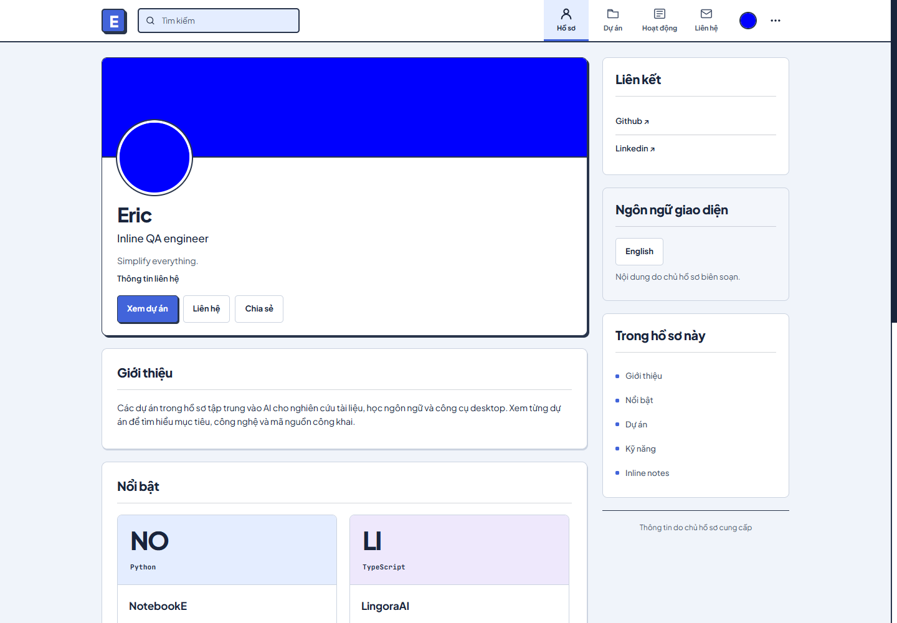
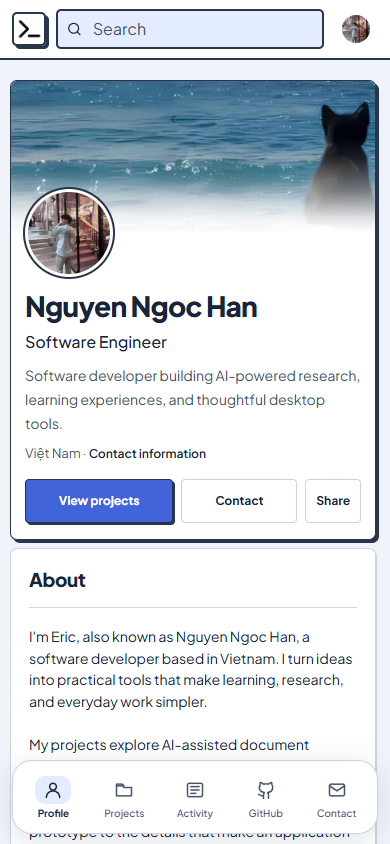
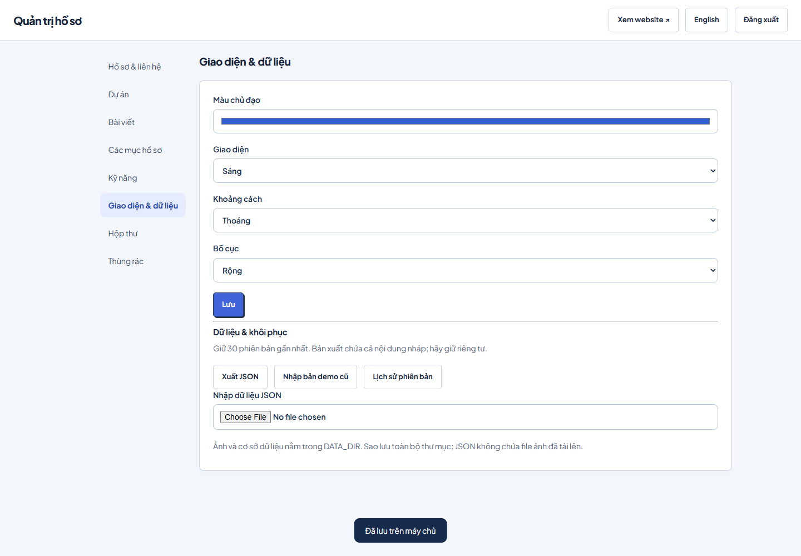

# Eric Profile

A personal profile and publishing website built with **Next.js, React, strict TypeScript and Node.js**. It combines a familiar professional profile layout with a private administration area for managing content without editing code.

**Production:** not deployed. No hosting account or production environment has been configured yet.

**Local website:** [localhost:3001](http://localhost:3001) · **Administration:** [localhost:3001/admin](http://localhost:3001/admin)

## Features

- Public profile with avatar, cover, introduction, social links and an optional downloadable PDF CV.
- Projects with images, technologies, descriptions, individual contribution fields, source/demo links and featured pinning.
- Posts with text, an image, a link, drafts, publishing and editable display time. Future posts remain private until their scheduled time.
- Experience, education, certifications and custom profile sections with editable entries.
- Search, project filters, grid/list presentation, reorder controls and individual visibility settings.
- Authenticated administration with server-side authorization, CSRF checks and HttpOnly session cookies.
- Persistent SQLite content and uploaded files. Redeployments preserve them when `DATA_DIR` is on persistent storage.
- Deleted entries can be restored from trash as drafts. The last 30 document revisions are available for full recovery.
- Contact form that saves real messages to the private administration inbox.
- Vietnamese and English interface, light/dark themes, readable accent colors, density and standard/wide layout settings.
- Explicit import of the previous browser mock or a JSON export, including embedded image/PDF migration.

GitHub links open the actual GitHub account and repositories. The profile sidebar also displays up to five languages from the public GitHub API. The site does not pretend to synchronize contributions or commits. Owner-authored descriptions and custom titles remain in their original language when switching the interface language.

## Screenshots

Screenshots are captured from the local production build using an isolated QA database. Example management entries shown there are test content.





## Stack

- Next.js App Router with server-rendered public pages and Node.js Route Handlers.
- React components and reusable typed administration forms.
- TypeScript in strict mode; Zod supplies validation and inferred domain types.
- Node.js 24 and its built-in SQLite driver.
- CSS design tokens, local Plus Jakarta Sans and JetBrains Mono fonts.
- ESLint, Prettier, Node's test runner and a browser QA script.

SQLite fits this single-instance personal website. The current persistence layer requires a writable persistent disk. An ephemeral serverless deployment needs a separate durable database and object-storage adapter.

## Local setup

Install **Node.js 24**, then run:

```sh
npm ci
npm run admin:create -- eric
npm run dev
```

The administrator command asks for a password of 12–256 characters. Terminal input is visible; alternatively supply `ADMIN_PASSWORD` through your secret manager. No default or shared password is built into the source. Re-running the command updates that user's password and invalidates their sessions.

Open [the website](http://localhost:3001) and [administration](http://localhost:3001/admin). The database is initialized automatically on first use; existing content is never replaced by startup seeds. The supplied sample posts start as drafts.

After signing in, return to the profile to edit in place. Small pencil buttons edit the adjacent section; camera buttons edit the avatar and cover. The navbar's **… → Settings → Profile sections** menu lets the administrator fill empty sections, edit hidden sections or add custom sections, without displaying placeholder cards to visitors. Section settings change the title, visibility and order. Changes save to the same database as the dashboard. Visitors see only published content and no editing controls or administration links. Appearance settings and sign out are also in the navbar **…** menu. Sign out there to return to visitor mode.

Image uploads include a framing preview: drag with a mouse or touch, use arrow keys to reposition (Shift for larger steps), and use the zoom slider. Avatar previews include a circular guide; covers use a 4:1 frame. Choose **Use this framing**, then **Save** to publish. Until framing is applied or cancelled, saving the form is disabled. Cancel keeps the saved image. Applied crops are exported as JPEG (800×800 avatars; 1600×400 covers); GIF uploads become still images. Reframing an existing image uses the saved crop, so choose the original file again to recover areas outside that crop.

## Environment

Copy `.env.example` to `.env` when configuration is needed. Keep `.env` and real passwords out of Git.

```dotenv
PUBLIC_ORIGIN=http://localhost:3001
DATA_DIR=.data
```

- `PUBLIC_ORIGIN`: exact browser origin without a trailing slash. Required for production writes. Use the actual HTTPS website origin when deployed.
- `DATA_DIR`: persistent location for `profile.sqlite`, its WAL files and the `uploads` directory. Default: `.data`.
- `PORT`: standalone server port; defaults to `3001`.
- `HOST`: standalone binding; defaults to `127.0.0.1`. Docker sets its generated server to `0.0.0.0`.
- `ADMIN_PASSWORD`: used only by the administrator setup command; never a browser-visible variable.
- `NEXT_TELEMETRY_DISABLED=1`: optional build/runtime telemetry setting.

Next.js loads local environment files in development. `npm start` loads `.env` before starting the standalone production server. Administrator CLI commands inherit `DATA_DIR` from the shell; if you use a custom location, supply that same value when creating the account.

## Administration

1. Sign in at `/admin`.
2. Use **Profile & contact** to update personal information, images, social links and the CV.
3. Use **Projects** or **Posts** to add, preview, edit, hide and delete entries. Select Draft or Publish in the form.
4. Use ↑ and ↓ to reorder entries. Scheduled posts use the timezone of your device when entered.
5. Use **Profile sections** to rename headings, reorder sections, toggle visibility or create a custom section. Its **Entries** button manages the entries inside it.
6. Use **Appearance & data** for theme, accent, density, layout, import/export and revision recovery.
7. Read contact messages in **Inbox** and restore deleted content from **Trash**.

Hiding a profile section affects its placement on the profile page; published projects and posts retain their dedicated pages. Hide or unpublish an individual entry to remove it from all public content.

Open an existing mock at the same browser origin and choose **Import previous demo** to migrate its `eric-profile-mock` localStorage data. For data from a different origin, import the exported JSON file instead. Import replaces the saved document after confirmation, retaining a recovery revision. JSON import is limited to 8 MB; image uploads support PNG/JPEG/WebP/GIF up to 3 MB and PDF CVs up to 2 MB.

## Checks and production build

```sh
npm run format
npm run format:check
npm run lint
npm run typecheck
npm test
npm run build
npm start
```

`npm run check` runs lint, type checking and automated API/domain tests. `npm start` serves the standalone build and keeps the data directory outside `.next`.

The API tests use temporary databases. Browser QA uses a separate production preview on port `3002` and `.qa-next-data`; it must never point at production. See [validation details](docs/VALIDATION.md).

## Deployment

A Docker configuration is included for a single Node.js instance behind an HTTPS reverse proxy:

```sh
# Set PUBLIC_ORIGIN in the host environment or a private .env file.
docker compose up -d --build
# Create your account inside the persistent application environment.
docker compose exec profile node scripts/create-admin.ts eric
```

The container exposes port 3001 to loopback on the host. Configure your reverse proxy and HTTPS certificate for the selected domain, forwarding requests to `127.0.0.1:3001`. The `profile-data` named volume persists data between container rebuilds. Do not delete that volume when upgrading.

For a normal Node server, keep `DATA_DIR` outside release directories and use `npm ci`, `npm run build`, then `npm start` under your process manager. Restart the process after deploying the new build. On Windows, stop a running standalone server before rebuilding because it locks the build directory.

A real deployment still needs a host, a domain or provider URL, HTTPS, persistent storage and access to that environment. No production deployment or Docker execution has been verified in this workspace.

## Backup and recovery

For a complete backup, stop the application and copy the entire `DATA_DIR`, including the database and uploaded files. Keep backups private: they include drafts, messages, administrator password hashes and sessions. Restore the directory while the application is stopped.

JSON exports contain content and appearance settings, including drafts. They do not include uploaded files, accounts or inbox messages. Revision history is a convenience for content recovery, not a replacement for an off-host backup.

## Structure and conventions

```text
app/          Next.js pages, route handlers and application styles
components/   Public UI, administration, forms, language context and icons
lib/          Zod schemas, persistence, authentication, API and typed helpers
scripts/      Account setup, standalone startup and optional browser QA
tests/        Isolated authorization, content, upload and persistence tests
src/          Retained design assets, fonts and legacy mock reference modules
.data/        Private runtime data — ignored by Git
```

The active application code is in `app`, `components` and `lib`. The earlier buildless prototype and Node server remain for reference; `npm` application scripts run Next.js. See [ARCHITECTURE.md](ARCHITECTURE.md) for responsibilities, formatting rules, comments and migration requirements.

Public project summaries are based on the owner-provided GitHub repositories. [CONTENT-SOURCES.md](CONTENT-SOURCES.md) records sources and limits; personal roles or measured outcomes have not been invented.

## GitHub profile and technology sidebar

The profile connects to the configured public GitHub account automatically, without OAuth or a token. A compact card shows repository/star/follower counts and the top five language chips. **Explore GitHub** opens the public bio, location/company, join date, following/fork counts and searchable repositories with descriptions, topics, primary languages, stars, forks, archive/fork flags and update dates. Search matches names, languages and topics. The card remains accessible on mobile even though other sidebar cards are hidden.

Languages are ranked by summed source-code bytes from GitHub’s [repository languages endpoint](https://docs.github.com/en/rest/repos/repos#list-repository-languages), excluding forks and empty repositories. This describes code distribution, not proficiency or framework knowledge. Repository and profile data use the public [repository list](https://docs.github.com/en/rest/repos/repos#list-repositories-for-a-user) and [user profile](https://docs.github.com/en/rest/users/users#get-a-user) endpoints. Existing site content and uploaded pictures are not overwritten by GitHub data.

The server paginates repositories, up to ten pages of 100, and requests languages four repositories at a time under a twelve-second deadline. A timeout, API limit, failed page or truncation is labelled as partial or unavailable. Private repositories, private account details, contribution history and authentication are outside this public integration. No full-account export is claimed.

Responses are cached in memory and under `DATA_DIR/github-cache` for one hour; unavailable responses expire after five minutes. No background worker is required: the next page request after expiry refreshes the data. Interface language, administrator section management, appearance settings and sign out remain in the navbar’s three-dot Settings menu.
