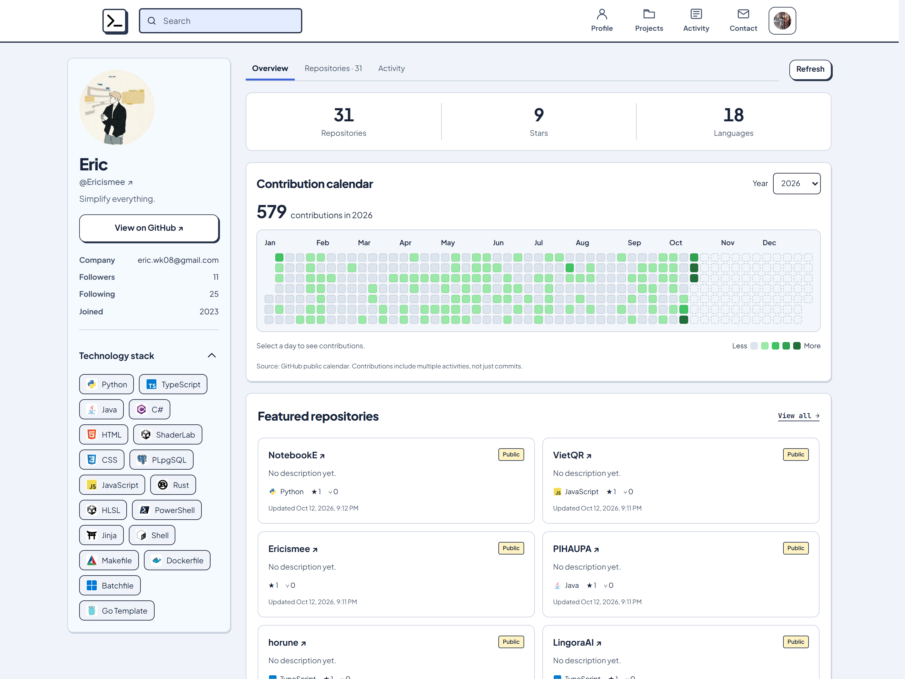
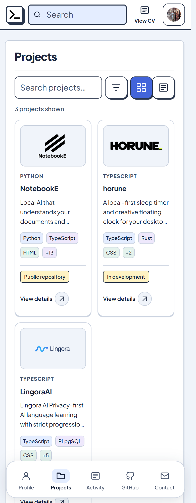
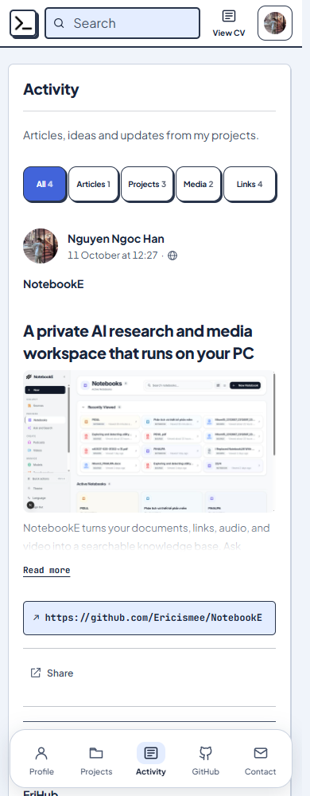
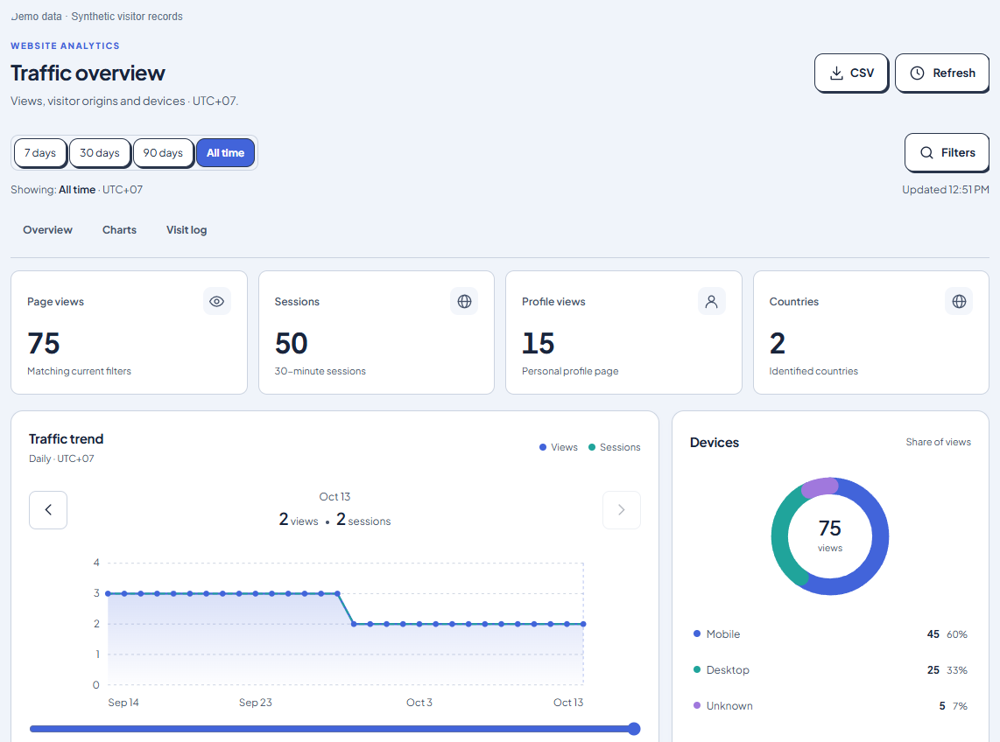
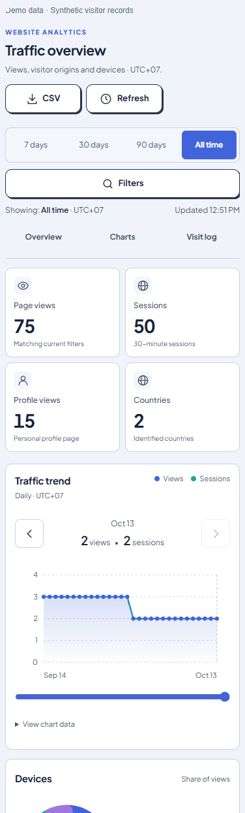

# Eric Profile

A personal portfolio with a publishing workspace, a GitHub activity dashboard and private website analytics. Built with Next.js App Router, React and TypeScript.

[Live website](https://ericisme.cloud) · [Deployment](docs/VERCEL-DEPLOYMENT.md) · [Backups](docs/BACKUPS.md) · [Security](SECURITY.md) · [MIT license](LICENSE)


## Explore the app

- **Profile** — introduction, featured projects, skills, education, social links and certificates. Education appears beside the profile identity; certificates support links and image/document previews. Activity has its own page to keep the profile concise.
- **Projects and publishing** — instant search, filters, grid/list layouts, rich text or Markdown, scheduled publication, drafts and recoverable trash. View images in a compact popup or read supported documents in the built-in preview.
- **GitHub** — repositories, a contribution calendar defaulting to the same rolling 12-month period as GitHub, optional calendar-year views, keyboard/touch date selection, technology stack and recent commits. Disclosure controls keep long sections manageable; event icons distinguish pushes, pull requests, issues and other activity.
- **Private administration** — inline editing, mobile-friendly forms, image framing, upload progress, revisions and optional authenticator-based two-factor authentication with recovery codes.
- **Traffic statistics** — filterable metrics, trends, country/device/browser breakdowns and a paginated visit log. Mobile controls include date presets, section shortcuts, chart-period buttons, a slider and expandable visit details. CSV exports follow the selected filters.
- **Presentation** — English/Vietnamese UI, light/dark themes, locally hosted fonts and persistent navigation. Background refresh pauses while editing or when the tab is hidden.

UI translations do not translate authored project descriptions or posts. The contribution calendar reports GitHub **contributions**, which include more than commits. “Last 12 months” and a calendar year are different totals; upstream caching can also delay new contributions by a few minutes.

### GitHub dashboard



### Mobile browsing

<p align="center">
  
  
</p>

### Analytics workspace



<p align="center">
  
</p>

Screenshots show the local preview. **Analytics screenshots use synthetic visitor records**, including documentation-only IP addresses, rather than real visitor data. The live website may contain different content.

## Run locally

Use **Node.js 24** and npm:

```sh
npm ci
```

Copy `.env.example` to `.env`. Keep `PUBLIC_ORIGIN=http://localhost:3001`, then create your own administrator:

```sh
npm run admin:create -- your-admin-name
npm run dev
```

Open [localhost:3001](http://localhost:3001), or `/admin` for the private workspace. The CLI asks for a password of 12–256 characters; terminal input is visible. There is no default administrator account. Running the command again resets that account's password and invalidates its sessions.

Local development uses SQLite and disk uploads. Keep the data directory and environment files outside Git.

## Deploy and operate

Vercel production uses PostgreSQL and a **private Vercel Blob store** for persistent content and uploads. Configure server-only environment variables:

- `DATABASE_URL` — PostgreSQL connection with verified TLS.
- `BLOB_READ_WRITE_TOKEN` — private Blob store credentials.
- `GITHUB_CREDENTIAL_KEY` — persistent 32-byte encryption key encoded as 64 hexadecimal characters.
- `PUBLIC_ORIGIN` — the canonical HTTPS origin, without a trailing slash.
- `BACKUP_ENCRYPTION_KEY` and `CRON_SECRET` — separate secrets for encrypted backups and the authenticated scheduler.

Never prefix credentials with `NEXT_PUBLIC_`. Use separate resources for preview and production; back up the database, uploads and encryption keys independently. **A code deployment does not synchronize the local database with production.**

Follow the [deployment and migration guide](docs/VERCEL-DEPLOYMENT.md) and [backup/recovery guide](docs/BACKUPS.md). For self-hosting, use persistent storage and review [Dockerfile](Dockerfile) / [compose.yaml](compose.yaml). Start a local production build with:

```sh
npm run build
npm run start
```

## Understand the analytics

All report dates use **UTC+07**. Metrics, charts, the visit log and CSV export use the active filters. The dashboard displays the applied report range, update status and record/page counts. If refresh fails, it identifies previously loaded results instead of presenting them as current.

- **Page views** count a page once within a 30-minute session; **sessions are not unique people**.
- Signed-in administrators and recognized bots are excluded. Blocked tracking or failed requests can differ from hosting-provider totals.
- Viewing time estimates how long the tab was visible. Older records without this measurement display `—`.
- IP-based location is approximate, not GPS. Some visits have no location or recognized device information.
- Detailed records and exports require an administrator session. Only an aggregate count is public. Visitor history has no automatic retention expiry.

See [analytics boundaries](SECURITY.md#analytics-boundaries) for privacy and collection limits.

## Uploads and previews

Files support up to **20 MiB**, with a **1 MiB** limit for static SVG. Images, PDF, DOCX, TXT and Markdown have preview support. DOCX previews show text; download the original to retain its formatting. Text files use UTF-8. Preview capability depends on file type and URL; external document links may open in their original service.

Raster images have responsive variants up to 2560px and higher-quality WebP encoding for Retina screens; originals and downloads stay unchanged and small sources are never enlarged. Processing is bounded to protect server resources.

Uploaded files retain visibility checks. Draft, hidden and unpublished attachments are not public simply because their URLs are known.

## Development and verification

```sh
npm run check                       # Lint, TypeScript and automated tests
npm run format:check                # Formatting
npm run build                       # Production bundle
npm audit                           # Known dependency advisories
npm run security:source -- --history # Source and available Git history
```

Tests cover authentication, CSRF, upload access, publication, concurrent edits, recovery, traffic filtering and CSV formula neutralization. Browser checks should include narrow mobile widths, keyboard navigation, empty/error states and both themes. Passing checks are not a guarantee against all vulnerabilities.

## Security

Administrative reads require server-validated sessions; writes also validate Origin and CSRF. Session cookies are HttpOnly and Secure in production. Passwords use scrypt; GitHub credentials, IP addresses and supplemental visitor context are encrypted at rest. Production pages use per-request script nonces and block inline event handlers. CSV export neutralizes spreadsheet formula prefixes.

Keep environment files, databases, tokens, keys, backups and content/visitor exports outside Git. Read [SECURITY.md](SECURITY.md) for the threat boundaries, validation process and private reporting instructions.

## License and content rights

Original application code is [MIT licensed](LICENSE). Fonts, dependencies and third-party artwork retain their own licenses; see [THIRD_PARTY_NOTICES.md](THIRD_PARTY_NOTICES.md).

Personal profile content, photographs, artwork and trademarks are not granted for reuse by the software license. Replace them when deploying your own portfolio. Screenshots illustrate this application rather than provide a reusable asset pack.
